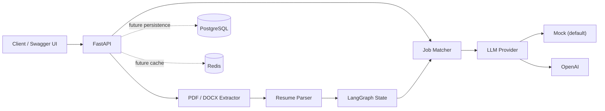

# CareerPilot v0.2


CareerPilot 是一个面向求职场景的 AI Agent 后端。v0.2 提供可直接运行的 FastAPI API、PDF/DOCX 简历上传、LangGraph 工作流骨架、离线简历解析与 JD 匹配基线，并预留真实 LLM、PostgreSQL 和 Redis 的扩展入口。

> An open-source AI career agent backend for resume parsing, document upload, and job matching.

> 当前版本默认使用 `mock` Provider，不需要 API Key，也不会把简历发送给第三方。它适合本地开发、演示和 CI；切换到 OpenAI 后，匹配接口会使用结构化模型输出。

## 已实现

- 简历纯文本解析：姓名、邮箱、电话和技术技能
- PDF、DOCX 简历上传与文本抽取（包括 DOCX 表格内容）
- 文件大小、扩展名、MIME、文件签名和 DOCX 解压大小校验
- 上传简历后直接进行 JD 匹配分析
- JD 匹配分析：匹配分数、已有技能、缺失技能、优势与建议
- LangGraph 两节点工作流：`parse_resume -> match_job`
- 可插拔 LLM Provider：Mock / OpenAI
- FastAPI 自动文档与 Pydantic 输入校验
- PostgreSQL 异步连接层、Redis 客户端入口
- Docker Compose 一键启动 API、PostgreSQL、Redis
- Pytest API / 工作流测试、Ruff 检查、GitHub Actions CI

## 架构



```text
src/career_pilot/
├── agents/                 # LangGraph 状态与节点
├── api/                    # 路由和依赖注入
├── infrastructure/         # PostgreSQL / Redis 连接入口
├── services/
│   ├── llm/                # Provider 接口、Mock、OpenAI、工厂
│   ├── document_extractor.py
│   ├── job_matcher.py
│   └── resume_parser.py
├── config.py
├── schemas.py
└── main.py
```

## 快速开始

### 方式一：Docker Compose（推荐）

需要 Docker Desktop 或 Docker Engine + Compose。

```bash
cp .env.example .env
docker compose up --build
```

启动后访问：

- Swagger API 文档：<http://localhost:8000/docs>
- 健康检查：<http://localhost:8000/api/v1/health>

停止服务：

```bash
docker compose down
```

如需同时删除本地数据库和 Redis 数据卷，可显式执行 `docker compose down -v`。

### 方式二：本地 Python

要求 Python 3.12；PostgreSQL 和 Redis 在 v0.2 接口中尚非强依赖，因此可以只启动 API。

```bash
python3.12 -m venv .venv
source .venv/bin/activate
python -m pip install -e ".[dev]"
cp .env.example .env
uvicorn career_pilot.main:app --reload
```

## API 示例

解析简历：

```bash
curl -X POST http://localhost:8000/api/v1/resumes/parse \
  -H 'Content-Type: application/json' \
  -d '{"text":"Jane Doe\njane@example.com\nBackend engineer using Python, FastAPI, PostgreSQL, Redis and Docker."}'
```

分析岗位匹配度：

```bash
curl -X POST http://localhost:8000/api/v1/matches/analyze \
  -H 'Content-Type: application/json' \
  -d '{
    "resume_text":"Jane Doe is a backend engineer skilled in Python, FastAPI and Docker.",
    "job_description":"We need Python, FastAPI, PostgreSQL and AWS experience."
  }'
```

上传 PDF 或 DOCX 简历：

```bash
curl -X POST http://localhost:8000/api/v1/resumes/upload \
  -F 'file=@./resume.pdf'
```

上传简历并直接分析 JD 匹配度：

```bash
curl -X POST http://localhost:8000/api/v1/matches/analyze-upload \
  -F 'file=@./resume.docx' \
  -F 'job_description=We need a backend engineer with Python, FastAPI, PostgreSQL and AWS.'
```

上传限制可通过 `MAX_UPLOAD_SIZE_MB` 和 `MAX_EXTRACTED_TEXT_CHARACTERS` 调整。当前支持文本型 `.pdf` 和 `.docx`；旧版 `.doc` 需要先另存为 `.docx`，扫描件 PDF 需要在后续 OCR 版本中处理。

离线算法只比较当前技能词典中的技能，结果可重复，适合作为 baseline，不应作为真实招聘决策依据。

## 使用 OpenAI Provider

修改 `.env`：

```dotenv
LLM_PROVIDER=openai
LLM_MODEL=gpt-4o-mini
OPENAI_API_KEY=your-key
```

重启后，两个匹配接口都会通过统一的 `LLMProvider` 请求结构化分析。生产部署应通过平台 Secret 管理密钥，不要提交 `.env`。

## 测试与质量检查

```bash
pytest -q
ruff check .
ruff format --check .
python -m build
```

CI 会在 push 到 `main` 或 Pull Request 时执行代码检查、测试和 Docker 镜像构建。

## 开源协作

欢迎提交 Issue 和 Pull Request。开始前请阅读：

- [贡献指南](CONTRIBUTING.md)
- [安全策略](SECURITY.md)
- [行为准则](CODE_OF_CONDUCT.md)
- [更新日志](CHANGELOG.md)

请勿在 Issue、日志或测试样本中提交真实简历、个人信息或 API Key。安全问题请使用 GitHub 仓库的私密漏洞报告功能。

## 发布到自己的 GitHub

在 GitHub 创建一个空仓库后，在项目目录中执行：

```bash
git remote add origin https://github.com/<your-account>/career-pilot.git
git push -u origin main
```

仓库已经包含 CI、Dependabot、Issue 模板和 Pull Request 模板。首次推送后，建议在 GitHub Settings 中启用 Branch protection、Private vulnerability reporting 和 Discussions。

## v0.3 建议

1. 引入 SQLAlchemy 数据模型与 Alembic，持久化用户、简历、职位和每次工作流运行。
2. 使用 LangGraph PostgreSQL checkpointer 保存状态，实现长任务恢复、重试和人工确认节点。
3. 增加扫描 PDF OCR、原文件对象存储、病毒扫描和隐私删除接口。
4. 使用 Redis 做解析结果缓存、速率限制；用任务队列执行耗时分析。
5. 增加 Resume Optimizer、Gap Analysis、Interview Agent，并把 Prompt 独立版本化。
6. 建立离线评测集，记录匹配准确性、延迟、Token 和费用；加入 tracing 与可观测性。
7. 增加认证、租户隔离、敏感字段加密和 API 滥用防护，再部署到云平台。

## 项目边界

v0.2 支持纯文本、文本型 PDF 和 DOCX，但暂不支持扫描 PDF OCR、旧版 `.doc` 或密码保护的 PDF。上传文件仅在请求期间读取，不会写入磁盘或数据库。数据库和 Redis 已完成开发环境配置与代码入口，但尚未用于业务持久化。匹配结果是辅助建议，不应作为自动筛选、录用或其他高风险人事决策的唯一依据。

## License

[MIT](LICENSE)
